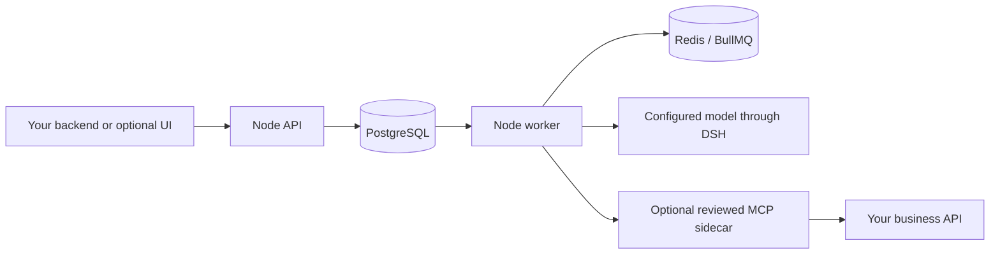

# Eldhall

Eldhall is a self-hosted support-agent service with an HTTP API and optional operator/customer UI. A model can look up scoped information and propose business actions; the application controls permissions, approval, execution and audit. PostgreSQL stores product state, and a separate Node worker uses Redis/BullMQ to process accepted work.

This is a **source-build preview**, not a published installable release. The selected public Docker Hub repositories contain no released images. No registry tag or pull-only bundle is available through this guide. Source-publication preparation does not establish that a public source repository or archive has been published. See [release status and limits](docs/RELEASE_STATUS.md).

## What it does

- Serves headless customer sessions, cases, messages and operator handoff through the [API](docs/API_CONTRACTS.md). The web UI is an optional client.
- Retrieves published, versioned [knowledge and prose skills](docs/KNOWLEDGE_BASE.md), with access checks and revision fencing.
- Connects an existing business API through a reviewed [OpenAPI → MCP catalog](docs/OPENAPI_QUICKSTART.md), or configured scoped legacy read-only MCP tools.
- Applies `auto / ask / deny` policy. An `ask` read or write creates a durable proposal and ends the bounded model turn; approval and execution are separate operator actions.
- Records action outcomes and audit with replay protection. An ambiguous external effect remains `unknown` for reconciliation rather than being blindly repeated.
- Provides English, Spanish, Ukrainian, German and Portuguese interfaces with saved language preferences, local formatting and localized landing pages. See [localization and adding languages](docs/LOCALIZATION.md).
- Structures case context and actions with twelve explicit business presentation templates and a generic fallback. See [template fields, reviewed tags and isolated examples](docs/INSPECTOR_TEMPLATES.md).
- Tracks customer requests inside one shared ticket conversation, with message provenance, revisioned action links and a catalog/detail operator view. See [request tracking, checkpoints and lifecycle boundaries](docs/REQUEST_CATALOG.md).

The built-in financial provider is **simulated**; refund identifiers do not represent real money movement. Staff authentication uses a deployment-wide operator bearer. SSO, invitations, complete RBAC and scoped host-service credentials are not implemented. Model/provider availability and output quality require their own evaluation.

## Processes and storage



API, worker and one-shot migrate share the server image. PostgreSQL and Redis remain separate services or explicit dependencies; UI and the Python OpenAPI sidecar are optional. Product records and native DSH session files use different persistent storage. [Architecture](docs/ARCHITECTURE.md) explains the trust and recovery boundaries.

## Build and run from source

Use Node.js 24.15+ within 24.x, PostgreSQL 17 and Redis 7. Install locked dependencies and build the API:

```sh
npm --prefix apps/api ci
npm --prefix apps/api run build
```

The [implementation guide](docs/implementation.md) covers explicit private environment/configuration, migrations, API/worker startup, optional UI and headless business/customer provisioning. Keep operator, database and model credentials on your backend. A [support configuration example](examples/support.config.json) shows knowledge, skills and connector declarations; example endpoints require replacement or removal.

For a source-built container stack, use the standalone [Compose recipe](deploy/support.compose.yaml) with the settings in the [self-host guide](docs/implementation.md#self-host-compose). Its current path uses local builds. The [external PostgreSQL recipe](deploy/support.external-db.compose.yaml) omits the bundled database; `DATABASE_URL` selects the actual write target. Migrations create Eldhall's tables, so use a dedicated compatible database and review backup/permissions before applying them. A connection URL does not map arbitrary business tables: expose those through a scoped MCP contract instead.

## Image-contained CLI and offline preparation

The locally built server image contains `eldhall`:

```sh
docker run --rm --network none --read-only LOCAL_SERVER_IMAGE eldhall help
docker run --rm --network none --read-only LOCAL_SERVER_IMAGE eldhall version
```

`LOCAL_SERVER_IMAGE` is your verified local build, not a registry tag. [Static config/release validation](docs/CLI.md) also runs without DB/Redis/model access. Linux [`eldhall init`](docs/INSTALLATION_INIT.md) prepares private `support.env`, empty `support.json` and a stable `installation.json` from an explicit request and credential sources. It reports **`prepared/unbound`**, does not start services, and proves no release/storage ownership or database schema epoch. Doctor, bootstrap and complete installation assembly are future work.

## Connect your business

To add the support agent to your application, start with the [integration guide](docs/AGENT_INTEGRATION.md). It includes HTTP requests, a [runnable Python example](examples/support_chat.py), operator handoff and business data setup. Use the [API reference](docs/API_CONTRACTS.md) for endpoints, request bodies and error handling.

1. Provision business/customer identity through the trusted [headless administration API](docs/API_CONTRACTS.md#headless-administration). Give the customer only their opaque session, never an operator key.
2. Add your published knowledge and approved [skills/configuration](docs/integrations-runtime.md). Existing centralized Qdrant can be configured for [read-only external retrieval](docs/EXTERNAL_DATA.md).
3. For actions, import a supported OpenAPI subset, inspect the exact operation definitions, configure trusted scope/target mapping, then review and activate the catalog through the operator API/UI. Follow the [walkthrough](docs/OPENAPI_QUICKSTART.md) and [manifest/permission contract](docs/integrations-manifest.md).

Business-specific credentials and configuration stay outside this source distribution. Connector activation is explicit; mounting a manifest does not enable operations automatically. The [synthetic Orders specification](examples/orders/openapi.json) is a test fixture, not a production adapter.

## Preview business presentation templates

With the frontend dependencies installed, run:

```sh
npm --prefix apps/frontend run demo:inspector
```

This source-only preview serves thirteen fictional businesses at
`http://127.0.0.1:5192/operator?lang=uk#key=1111`. Its fixture API is bound to
`127.0.0.1:5293`; both listeners stop with the launcher. It loads no database or
deployment environment file and executes no business actions. The demo key is
only for these synthetic loopback fixtures. It does not configure a production
operator key, activate an integration or change the normal demo's stored data.

## Verify a source checkout

```sh
npm --prefix apps/api run lint
npm --prefix apps/api run typecheck
npm --prefix apps/api test
npm --prefix apps/api run build
python3 -m unittest discover -s scripts/tests -p test_source_archive.py -v
```

The ordinary API tests require Node/native runtime support, not Docker or paid model calls. Explicit [Compose interoperability and private Linux init checks](docs/INSTALLATION_INIT.md) are separate lanes. PostgreSQL/MCP/runtime suites and frontend checks have their own prerequisites in the [implementation guide](docs/implementation.md#verification-and-current-limits). Native AMD64/ARM64 source-build evidence is distinct from registry-image install and restore evidence.

## License and distribution boundaries

Project-authored software is [Apache-2.0](LICENSE); preserve [NOTICE](NOTICE) and [licensing scope](docs/LICENSING.md). Dependencies, native components and separately pulled services keep their own terms. Redis 7.4 is not Apache licensed. [Third-party notices](docs/THIRD_PARTY_NOTICES.md) and [native review inputs](docs/NATIVE_RECEIPTS.md) describe the remaining source/notice review obligations.

The [distribution contract](docs/distribution-contract.md) separates implemented metadata/CLI from the outstanding publication, compatibility, installer and restore gates. This source preview does not promise a supported production release.

Single-workspace banking setup, versioned skills/guards and live-evaluation boundaries: [banking sandbox](docs/BANKING_SANDBOX.md).
