# Implemented architecture

Current TypeScript support MVP. See [implementation/start](implementation.md), [API contracts](API_CONTRACTS.md) and [runtime/configuration](integrations-runtime.md). [architecture-review.md](architecture-review.md) is a broader target proposal.

```mermaid
flowchart LR
  Customer[Optional customer chat or host client] -->|X-Customer-Session| API[Fastify API]
  Staff[Optional operator UI or API client] -->|Operator bearer| API
  API -->|Messages and durable outbox| PG[(PostgreSQL)]
  PG -->|Pending turns and fenced leases| Worker[Dedicated Node worker and relay]
  Worker -->|Publish accepted run IDs| Redis[(Redis / BullMQ)]
  Redis -->|At-least-once delivery| Worker
  Worker --> DSH[Native DSH model/tool loop]
  Worker --> Classifier[Optional OpenRouter Decisions classifier]
  PG -->|Insight runs: SKIP LOCKED claims| Worker
  DSH --> Gateway[Trusted parent tool gateway]
  Gateway -->|Legacy scoped reads| MCP[Configured MCP server]
  Gateway --> Dispatcher[Node permissions, guards and execution admission]
  API -->|Review, activate, policy edits| PG
  API -->|Approve then execute| Dispatcher
  Dispatcher <-->|Catalog revisions and execution ledger| PG
  Dispatcher -->|Authenticated MCP| Sidecar[Python fixed-target OpenAPI sidecar]
  Sidecar -->|Reviewed operation and trusted scope| Upstream[Business API]
  Worker -->|Proposals and final messages| PG
  API -->|Separate approved execution| Payment[Simulated payment provider]
  Payment -->|Recorded result and audit| PG
```

## Processes and state

API and dedicated worker share one Node/TypeScript application. PostgreSQL is authoritative for product state. Redis/BullMQ delivers work and can be reconciled from the PostgreSQL outbox; it is not the only record of accepted input. The starter jobs queue remains alongside the support-turn queue.

Persistent message POST commits the customer message and turn job atomically, returning HTTP 202 with `reply:null` and `runId`. The worker relays pending rows, claims a renewable 30-second fenced lease and coordinates one bounded turn. Leases renew every five seconds; recovery is bounded to three claims. Unique active-turn/logical-proposal constraints and atomic final-message/job completion guard redelivery. A supplied `clientMessageId` deduplicates the same input. See [turn processing](../apps/api/src/modules/support/turn-processor.ts) and [PostgreSQL claims](../apps/api/src/modules/support/postgres-turn-jobs.ts).

Staff takeover invalidates the previous bot run and pending approval. Replies require staff ownership; bot resume is explicit. Knowledge revocation, skill revision and policy changes fence stale output. Explicit memory/inline mode is a reset-on-restart development demo.

## Model loop and trust boundary

[DshSupportModel](../apps/api/src/runtime/dsh-model.ts) uses native DeepSeek Harness `0.2.2-alpha.2`. The selected model is Google `gemini-3.5-flash-lite`, configured with server-only `GEMINI_API_KEY`. Other supported providers and an explicitly configured compatible local endpoint use the same adapter. The Vercel AI SDK model/spike were removed; DSH is the model engine. Rules mode is an explicit offline option and a labelled fallback on model failure.

[The dedicated profile](../apps/api/src/runtime/profile.ts) starts from an empty preset/bundle composition and loads a fixed allowlist of runtime services and the support gateway. Three parent-controlled tools are exposed: `lookup_payments`, `search_knowledge`, `submit_decision`. Configured legacy reads or reviewed external operations optionally add `call_business_tool`; the backend determines which operations need approval. The model cannot execute refunds, choose MCP URLs/credentials or use model-facing shell/filesystem tools. Identity and scoped payment data come from authenticated application state, never IDs asserted in message text.

The parent owns validation, data access and effects. DSH owns the model/tool loop and native sessions under persistent `RUNTIME_HOME`, separate from PostgreSQL product messages/runs/audit. Normal turns resume the conversation session with a bounded current product snapshot; recovered attempts use isolated checkpoints. Deadlines, cancellation and ownership checks fence tool output and close the runtime child. A child process is not an operating-system security boundary.

### Configurable ticket categories

Business-scoped `classifications` define versioned IDs, labels, descriptions, examples, an `other` fallback and a review threshold. Categories are independent of the fixed financial intent, priority and permissions. Persisted revision/tombstone watermarks prevent an old startup file from restoring a disabled or newer edited taxonomy; in-flight changes fence stale output. Historical results retain the original label/revision. A low-score result keeps the proposed class and its score separate from the final fallback class.

With `CLASSIFICATION_PROVIDER=openrouter`, [the dedicated adapter](../apps/api/src/modules/agent/openrouter-classifier.ts) calls the fixed alpha Decisions endpoint using `openai/gpt-6-luna-decisions`. The winning option probability is a model score, not measured accuracy; provider failure returns `other` for review. Conversation/tool work remains DSH/Gemini. With the default `agent` classifier, the bounded DSH decision supplies the category. See [configuration](integrations-runtime.md) and [OpenRouter setup](openrouter.md).

### Ticket and knowledge insights

An operator admits a business-scoped analysis run; the ordinary worker polls its durable PostgreSQL row with `SKIP LOCKED`, renewable leases and fence checks. These analysis jobs do **not** use the customer-turn BullMQ queue. A bounded repeatable-read snapshot supplies ticket/message and published KB excerpts to a dedicated DSH profile exposing only `submit_insights`. Findings cite validated sampled evidence; recurrence counts derive from distinct cited tickets. Possible KB gaps/contradictions remain hypotheses, not population rates or confirmed causes.

Changed/revoked sources hide stale derived findings. Creating a KB draft is idempotent per finding and performs no publication. Drafts include provenance and a verification notice; normal staff-managed publication remains separate. See [Insights limits and API](insights.md).

## Policy, approval and execution

[SupportHarness](../apps/api/src/modules/agent/harness.ts) coordinates context, decision/fallback, proposals and backend-owned replies. [Deterministic policy](../apps/api/src/modules/agent/policy.ts) checks ownership, captured state, equal amount/currency/reference within the duplicate window, the later duplicate target, full refund amount, enabled tool and business limit. Sentiment changes priority/tone/escalation and never authorizes a refund.

`POST .../approve` records consent for the exact `argsHash`; it does not dispatch the payment action. Separate `POST .../execute` requires unexpired approval, rechecks current guards and atomically reserves the payment. Payment/proposal uniqueness and provider idempotency prevent another dispatch. Unknown outcomes retain the reservation for manual reconciliation rather than blind retry. Backend-owned action-status messages follow recorded execution state; refund/duplicate intents use owned templates. General informational model prose also uses prompt instructions and heuristic filtering, which do not establish an unrestricted semantic guarantee. See the [state contract](API_CONTRACTS.md).

## Data and configuration

### Reviewed external operations

The OpenAPI integration boundary is a versioned manifest shared by the TypeScript backend and the Python `apps/mcp-openapi` sidecar over authenticated MCP Streamable HTTP. Import is deterministic and deployment-owned; it does not use an LLM. Business API credentials stay in the sidecar. The model receives a fixed `call_business_tool` facade, reviewed input schemas and bounded projected results.

PostgreSQL holds immutable catalog revisions and authoritative integration activation, reviewed operations and optimistic policy revisions. Configuration supplies deployment targets and initial artifacts; restarting an older file cannot restore operator-revoked access. The resolver applies an explicit operation rule first, then the strictest matching group rule, then the integration default. New or changed operations require review regardless of the effective `auto / ask / deny` rule.

Reads in `auto` run through the scoped dispatcher. `ask` reads and writes create durable proposals; approval records consent, and execute is separate. Explicit `auto` writes use the same ledger and guards. Execution admission is serialized with integration changes and case ownership; the remote request runs after database locks are released. A dispatched write may finish after takeover, so its outcome is still recorded while stale model delivery is fenced. Stable action identity and provider idempotency bound retries; an ambiguous effect remains `unknown` for reconciliation, not an automatic repeat. See [the integration contract](integrations-manifest.md) and [operator API](API_CONTRACTS.md).

A durable approval request ends the bounded model turn immediately. An application-owned latch blocks subsequent tools and builtin actions; native runtime control is sent outside business-result JSON. Upstream data cannot create that control state. The worker does not wait for a human while holding the turn lease; approval and execution happen through later requests.

The sidecar reports the reviewed upstream target/principal fingerprint and connection revision. Node verifies them at readiness and each call, alongside the manifest identity. Credentials are excluded from these fingerprints; the deployment supplies a nonsecret principal label and trusted identity mappings. Policy edits take effect from the database, while changed targets, artifacts or mappings require a reviewed deployment and process restart.

[0002_support.sql](../apps/api/migrations/0002_support.sql) creates `support_*` businesses, sessions, payments, cases/ownership, messages/source references, proposals, payment execution reservations, simulated refunds, audit, runs, knowledge, skills and settings. [0003_support_turns.sql](../apps/api/migrations/0003_support_turns.sql) adds durable jobs, leases/fences and input/proposal deduplication. [The migration runner](../apps/api/src/migrate.ts) retains starter jobs compatibility checks. Startup rejects missing support queue schema.

[0004_classification.sql](../apps/api/migrations/0004_classification.sql) persists taxonomy configuration and its private revision watermark; [0005_insights.sql](../apps/api/migrations/0005_insights.sql) adds analysis runs, evidence and draft linkage. Staff endpoints fail closed for a missing operator key, and production rejects known example credentials.

[0006_knowledge.sql](../apps/api/migrations/0006_knowledge.sql) adds knowledge persistence; [0007_external_knowledge.sql](../apps/api/migrations/0007_external_knowledge.sql) records external knowledge dependencies. [0008_integrations.sql](../apps/api/migrations/0008_integrations.sql) adds the external execution ledger and integration policy/review state; immutable manifests are stored separately from mutable activation and permissions. Apply the complete migration chain before upgrading the processes.

`SUPPORT_CONFIG_FILE` loads reviewed JSON at startup: initial businesses, versioned documents, reviewed Markdown/prose skills, legacy read-only MCP integrations and versioned OpenAPI catalogs. Persisted settings control existing business policy. Higher resource revisions can update stored rows; conflicting equal revisions fail and lower revisions do not replace newer edits. Search is hybrid retrieval (BM25 + local/OpenAI/Google embeddings, RRF; pgvector when available, otherwise in-process) over published, customer-audience, plan-scoped business knowledge; SKILL.md packs import into this file with `src/scripts/kb-import-skills.ts`. Skills guide the model but grant no permissions. MCP injects authenticated business/customer scope, projects approved output fields and requires upstream ownership enforcement. Restart both processes to load changed configuration.

## Clients, deployment and limits

React/Vite supplies the optional operator dashboard, Integrations editor and `/chat`; headless APIs remain primary. Vite/Caddy use same-origin proxies. Independent clients may use explicit CORS origins with GET/POST/PATCH and `X-Customer-Session`; credential cookies are disabled. One operator bearer maps to the bootstrap staff principal; customer sessions are opaque bearers. OAuth, invitations and full RBAC are not implemented.

[Standalone Compose](../deploy/support.compose.yaml) has PostgreSQL, Redis, migration, API and worker plus the optional `ui` profile. [The config overlay](../deploy/support.config.compose.yaml) mounts JSON read-only and optional connector environment. Product/runtime data use persistent volumes; ports bind private loopback. ARM64 CI builds and starts the standalone stack with the MCP overlay and verifies synthetic read, approval, execution and guard scenarios. Production rollout has a separate deployment gate; see [current evidence](STATUS.md). Landing, Umami and starter deployment tooling are preserved separately.

Payments are **simulated**. Real payment adapters, SSO/RBAC and managed multitenancy remain outside this implementation. Legacy MCP connections are read-only; reviewed OpenAPI catalogs have a separate controlled external-action path. No license has been selected. Current verification and release checks are in [STATUS.md](STATUS.md).
