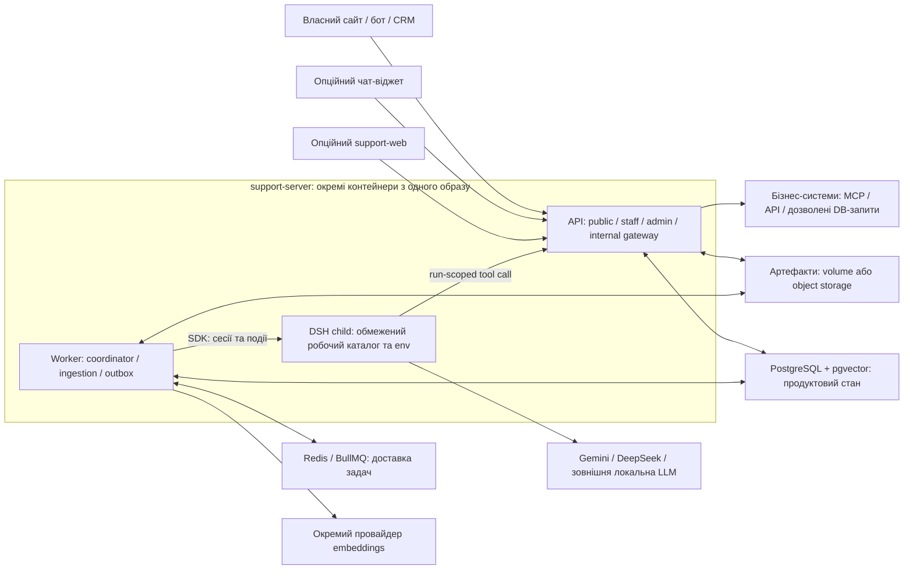
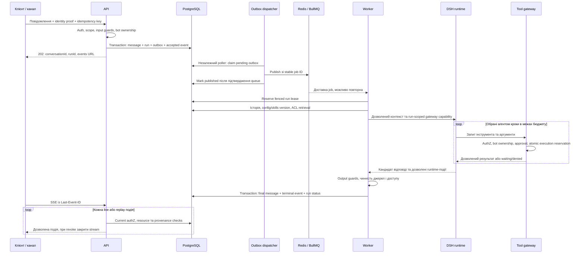
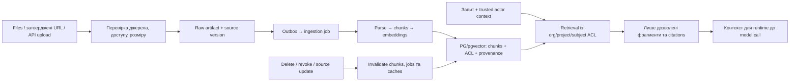
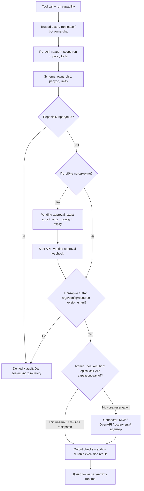
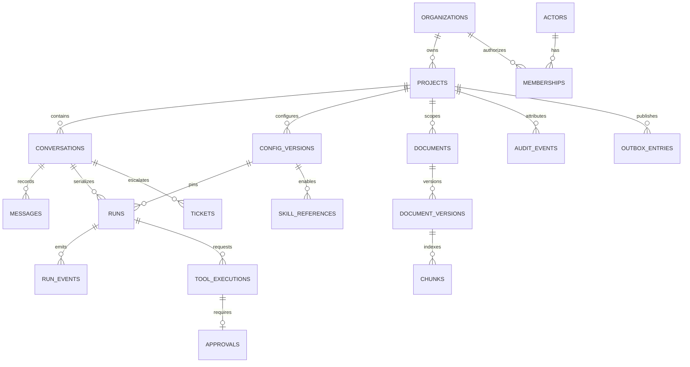

# Архітектура AI Support: пакет для командного рев’ю

**Дата: 31 жовтня 2026. Статус: пропозиція на рев’ю, до початку build.**
Документ описує цільову структуру та поведінку, а не реалізований продукт або результати тестів.
Читати разом із [бізнес-моделлю](business-model.md) та [правилами інтеграцій](integrations.md).
Поточний репозиторій — `D:\comp-prep`, робоча назва продукту — `hackathon-polytech`.
Папку не перейменовано. У `main` залишається Python-шаблон; є гілка `codex/node-backend`.
TypeScript нижче є рекомендацією для погодження командою; перемикання гілки чи переписування ще не відбулися.

Зміст: [рішення](#decisions) · [система](#system) · [структура](#structure) · [хід діалогу](#turn)
· [знання](#knowledge) · [інструменти](#tools) · [дані](#data) · [API](#api)
· [конфігурація](#config) · [розгортання](#deployment) · [перевірки й етапи](#delivery) · [погодження](#review).

<a id="decisions"></a>
## 1. Що пропонуємо погодити

Продукт — агент підтримки: клієнтської, технічної або внутрішньої для команди.
Вбудовані support-skills дають початкову спеціалізацію; потрібні навички обираються під звернення.
Власні перевірені skills доповнюють або явно замінюють вибрані навички через конфігурацію.
Єдиного обов’язкового лінійного workflow для всіх звернень немає.

| Питання | Пропозиція | Статус |
| --- | --- | --- |
| Основний контракт | API; dashboard і віджет — незалежні опції | Погоджений продуктовий напрям |
| Поставка | Безкоштовний self-host та платний managed cloud зі спільним ядром | Погоджений напрям |
| Мова продукту | TypeScript, Node.js/Fastify; React/Vite для dashboard | Рекомендація на командне рев’ю |
| Архітектура | Модульний моноліт, два серверні процеси: API та worker | На рев’ю |
| Agent runtime | DeepSeek Harness — перший і типовий runtime через тонкий SDK-адаптер | Вибір погоджено користувачем; деталі інтеграції потребують spike |
| Моделі | Gemini API для старту; DeepSeek або локальний endpoint як провайдери | Погоджений напрям |
| Стан | PostgreSQL + pgvector; Redis/BullMQ для доставки задач | На рев’ю |
| Ліцензія і тарифи | Остаточний вибір не зроблено | Окреме рішення перед публікацією |

Harness та AI-провайдер — різні рівні. Використання Gemini всередині DSH не потребує Gemini CLI.
Перевикористовуємо agent loop, сесії та механізми skills DSH там, де вони відповідають нашим контрактам.
Наш тонкий адаптер керує lifecycle і переводить події; core зберігає діалоги, tools/authZ, знання, approvals та audit.
Другий агентний engine і LangGraph до MVP не входять. Власний engine розглядаємо лише за підтвердженої потреби.
Заміна runtime потребуватиме адаптера, поведінкових тестів і міграції або перебудови session state;
вплив на контракти діалогів та інтеграцій оцінюватимемо при такій заміні.

<a id="system"></a>
## 2. Процеси, контейнери та межі системи

<!-- diagram:system -->


API є точкою автентифікації та виконання конекторів. Worker координує тривалі задачі й агентні сесії.
DSH пропонує tool calls через внутрішній gateway; бізнес-конектори виконуються поза модельним runtime.
Спільний процес API для public/admin/gateway — організаційна межа модулів, а не ізоляція безпеки.
Runtime отримує лише модельні credentials і короткоживучий scope до gateway для конкретного run.
Його env не успадковує DB/admin-ключі бізнес-систем; каталог не містить їхніх конфігів чи secret mounts.
Сам subprocess не є sandbox. Для недовірених скриптів потрібні OS-sandbox і мережеві обмеження.
У MVP custom skills — перевірений Markdown; довільні скрипти й неперевірені runtime-плагіни не допускаються.
До build потрібен DSH spike: підтвердити, що profile дає лише scoped gateway-tools конкретного run.
Прямий shell, довільний filesystem і зовнішній MCP у runtime вимкнені: вони не повинні обходити gateway.
Якщо потрібну межу profile не забезпечує, змінюємо адаптер/runtime до реалізації бізнес-інструментів.

<a id="structure"></a>
## 3. Повна цільова структура репозиторію

Нижче майбутнє дерево, а не вже створені каталоги. Спочатку модулі можна тримати в одному package;
окремий каталог не означає мікросервіс, окремий деплой або обов’язкову публікацію в npm.

```text
hackathon-polytech/
  apps/
    api/src/
      bootstrap.ts                  # env, validated config, composition root
      server.ts                     # HTTP, lifecycle, readiness
      http/public/                  # conversation API для каналів і клієнтів
      http/staff/                   # оператори, тикети, погодження
      http/admin/                   # config, джерела, skills, integrations
      http/internal/                # scoped tool gateway для runtime
      composition.ts                # з’єднання core та адаптерів
    worker/src/
      bootstrap.ts
      processors/agent-turn.ts      # один активний run на діалог
      processors/ingest-documents.ts
      outbox/dispatcher.ts           # незалежний startup polling loop
      recovery/                     # lease, restart, waiting approvals
      composition.ts
    web/src/                        # опційний React dashboard
      features/{inbox,knowledge,settings,approvals}/
      app/                          # маршрути та auth клієнта
  packages/
    core/src/
      modules/
        identity/                   # org/project, actor, permissions
        conversations/              # messages, runs, durable events
        agent/                      # coordinator, runtime ports, context
        knowledge/                  # ingest, retrieval, provenance, ACL
        skills/                     # presets, selection, review, versions
        integrations/               # tool catalog, gateway policy, ports
        approvals/                  # exact-args approval lifecycle
        tickets/                    # create, handoff, resolution
        audit/                      # attributable action records
      ports/                        # storage, queue, clock, files interfaces
    contracts/src/
      schemas/                      # runtime validation, HTTP DTO
      events/                       # публічні та внутрішні event contracts
      config/                       # versioned config, validation results
    runtime/src/
      interface.ts                  # start/resume/cancel та neutral events
      deepseek/                     # SDK lifecycle, event translation
      profiles/                     # обрані tools, дозволи, workspace
    connectors/src/
      mcp/                          # зовнішні MCP-сервери
      openapi/                      # вибрані operationId
      http/                         # пізніше: явно описані REST-операції
      postgres/                     # пізніше: named prepared queries/views
      auth/                         # server-side credential resolution
    storage/src/
      schema/                       # продуктові таблиці й індекси
      repositories/                 # реалізації core ports
      migrations/                   # версійовані міграції
      files/                        # volume / object-storage adapters
    client/src/                     # опційний клієнт стабільного API
    widget/src/                     # опційний незалежний browser bundle
  skills/support/
    triage/SKILL.md
    knowledge-answer/SKILL.md
    troubleshooting/SKILL.md
    ticket-handoff/SKILL.md
    resolution/SKILL.md
  examples/
    configs/support.yaml            # тільки валідні для релізу приклади
    headless/                       # повний сценарій без web-контейнера
    shop/                           # приклад support-інтеграції
    custom-skills/order-support/SKILL.md
    local-models/                   # окремі generation/embedding settings
  deploy/
    compose.yaml                    # API, worker, PG, Redis; UI profile
    compose.local-models.yaml        # опційний зовнішній модельний сервер
    Dockerfile.server
    Dockerfile.web
  tests/{contracts,integration,e2e,failure}/
  docs/{business-model,integrations,architecture-review}.md
  .github/workflows/{ci,images}.yaml # checks та публікація версійованих images
  scripts/{smoke,release}.ts         # перевірка розгортання та release-кроки
  .env.example                     # параметри, без справжніх secrets
  .dockerignore
  pnpm-workspace.yaml
  tsconfig.base.json
  package.json                      # workspace-команди; після вибору TS
```

Напрям залежностей: `contracts` не імпортує застосунки; `core` залежить від контрактів і власних ports.
`storage`, `runtime`, `connectors` реалізують ports і залежать від core, а не навпаки.
Composition roots в `apps/api` та `apps/worker` збирають реалізації; HTTP-handler не виконує SQL напряму.
Web/widget/client використовують лише публічні контракти; серверні credentials до browser bundle не потрапляють.
Skills містять інструкції та метадані версії, але не змінюють права користувача або список дозволених tools.

<a id="turn"></a>
## 4. Як проходить одне звернення

<!-- diagram:turn -->


Одночасно активний лише один run bot-owned діалогу: durable coordinator резервує його в БД; нові повідомлення очікують черги.
Lease має fencing token; старий worker після втрати lease не може підтвердити run чи виконувати його tools.
Скасування перевіряється перед викликами; після відправлення зовнішнього запису воно не означає rollback бізнес-системи.
Повідомлення, run і outbox створюються однією транзакцією. Dispatcher починає незалежний poll при старті процесу,
не очікуючи queue job для власного запуску; claim → publish stable job → mark published. Падіння між кроками дає повтор доставки.
BullMQ доставляє щонайменше один раз: стабільний job ID і БД-дедуплікація захищають від повторної оркестрації.
Exactly-once для зовнішніх дій не обіцяємо; правила повторів та невідомого результату описані нижче.
Run/events живуть у PostgreSQL. Redis може сигналізувати про нові події, але не є джерелом історії.
SSE має durable event ID; current authZ та resource/provenance ACL перевіряються перед КОЖНОЮ live/replay видачею.
Revoke закриває вже відкриті потоки. History/replay повторно фільтрують відкликаний вміст і похідні повідомлення;
невизначені права блокують видачу, а вже доставлений клієнту текст технічно відкликати неможливо.
При guards, що потребують повної відповіді, текст буферизується до перевірки; наживо йде лише дозволений progress.
Приховані міркування моделі, сирі credentials і неперевірені tool outputs у клієнтський stream не передаються.

Conversation ownership: `bot → pending_handoff → staff → resolved`; повернення у `bot` — лише явна дія уповноваженого staff.
Handoff/takeover транзакційно змінює ownership version, зупиняє/скасовує активний run та інвалідує його нові tools і final delivery.
У `pending_handoff`/`staff` нові customer messages зберігаються й маршрутизуються staff без автоматичного agent run.
Оператор відповідає через staff API; explicit `resume-bot` перевіряє права й ownership та запускає новий run із чинного контексту.
У `resolved` новий запит потребує погодженого переходу життєвого циклу; старий bot-run не відновлюється самостійно.
Takeover/cancel не відкочує вже надісланий зовнішній запис; його результат фіксується або переходить у `unknown` для reconciliation.

<a id="knowledge"></a>
## 5. Документи, індексація та пошук

<!-- diagram:knowledge -->


Джерела є даними, а не інструкціями вищого рівня. Текст документа не активує skill, MCP чи новий дозвіл.
Worker використовує версію джерела й embedding-моделі; повтор job не створює дубль активного індексу.
Вибірка обмежується правами до складання prompt; фільтр після модельної відповіді не замінює цього кроку.
До видачі відповіді повторно перевіряємо чинність використаних джерел: revoke під час run блокує її видачу.
Видалення/відкликання закриває джерело для нових вибірок, інвалідує chunks/caches та незавершені ingestion jobs.
Також інвалідуємо runtime history, summaries і похідний контекст із цим джерелом; контекст перебудовуємо з чинних даних.
Provenance зберігає залежність від source version. Уже видану відповідь технічно відкликати неможливо.
URL-fetch обмежений конфігурацією адміністратора, redirect/мережевими правилами, типом і розміром даних.
Generation та embeddings мають окремі endpoint/model/credential settings; повністю локальний режим потребує обох.
Міграція embedding-моделі означає нову версію індексу; вектори різних просторів не змішуємо.

<a id="tools"></a>
## 6. Авторизація інструментів і погодження дій

<!-- diagram:tools -->


Channel API key засвідчує інтеграцію та її scope, але сам по собі не доводить особу кінцевого клієнта.
Customer identity походить із перевіреної сесії або підписаного твердження довіреного каналу; анонімний клієнт має public scope.
Staff і admin мають окремі ролі. Org/customer IDs з аргументів моделі не створюють trusted auth context.
Ownership перевіряє наш gateway та бізнес-система або явно налаштований адаптер до виклику.
Allowlist і MCP annotations не є авторизацією. Відсутній custom `guards` не вимикає базові перевірки.
Для запису approval прив’язаний до canonical args hash, операції, первинного actor, config version, строку дії та approver.
Зміна аргументів/ресурсу/політики потребує повторної перевірки й, за потреби, нового approval; старе погодження не розширює права.
Рішення приймає уповноважена людина через API або автентифікований webhook; dashboard для цього не потрібний.
Перед фактичним виконанням знову перевіряємо actor, поточну політику, lease і строк погодження.
Gateway атомарно резервує `ToolExecution` за stable logical call ID до відправлення операції; повтор і run takeover використовують той самий ID.
Перевірка чинного lease/ownership і нова reservation виконуються одним узгодженим переходом у БД.
ID та canonical args hash фіксує backend; інші аргументи під тим самим ID відхиляються. Повтор не створює друге виконання.
Connector передає idempotency key далі, якщо бізнес-провайдер гарантує відповідну семантику.
Fencing зупиняє нові виклики старого worker, але не скасовує upstream-запис, який уже в польоті.
Покинутий `executing` після збою/lease takeover стає `unknown`, а не вільним для повтору.
Reconciliation або ручний розгляд установлює результат; повторний dispatch допустимий лише за доведеної upstream idempotency
з тим самим ключем або підтвердження, що попередня дія не відбулася. Лише локальна дедуплікація цього не доводить.
DB-адаптер на наступному етапі виконуватиме лише named prepared queries/views із мінімальною роллю; довільного SQL немає.
Schema/output checks і розмежування повноважень не є обіцянкою повного виявлення prompt injection.
MCP/OpenAPI discovery, `$ref`, redirects і цільові URL конекторів проходять approved egress policy.
Credentials прив’язані до origin інтеграції та не пересилаються через redirects на інший origin.
Cloud metadata/internal endpoints закриті, крім явно дозволеної self-host/private мережі потрібного конектора.

<a id="data"></a>
## 7. Продуктові дані та їхній життєвий цикл

<!-- diagram:data -->


Усі продуктові записи мають org/project scope; усі репозиторії вимагають trusted scope, включно з фоновими задачами.
Повідомлення зберігають роль і автора; runtime session reference є технічним посиланням, а не єдиною історією діалогу.
Messages/runs/audit зберігаємо в PostgreSQL; нативний session state DSH — у підтримуваному runtime store/home.
Resume іншим worker потребує доступу до цього store або підтримуваного перенесення; переносимість перевіряємо в spike.
Conversation містить ownership state/version та staff assignment; ці поля перевіряються при message routing, tools і final delivery.
Runs містять config/skill versions, model route, статус, fencing token і причину завершення; events мають порядок для replay.
Tool executions зберігають аргументи з належним захистом, результат/невідомий стан та зв’язок із approval й audit.
Config/skill snapshot забезпечує відтворюваність, але поточне відкликання доступу має пріоритет над snapshot.
Raw artifacts зберігаються через `FileStore`: локальний volume для self-host, object-storage adapter для cloud.
Окремий object-storage сервіс не є обов’язковою залежністю MVP; retention та видалення застосовуються і до файлів, і до індексу.

<a id="api"></a>
## 8. Пропоновані HTTP-контракти, події та стани

Це перелік майбутніх ресурсів, не наявні endpoints. Кожен route проходить runtime schema validation і authZ.

| Endpoint / ресурс | Доступ | Результат |
| --- | --- | --- |
| `POST /v1/conversations` | Customer/channel у своєму scope | Новий діалог |
| `POST /v1/conversations/{id}/messages` | Авторизований учасник | `202`, message; run лише для bot-owned, інакше staff routing |
| `GET /v1/conversations/{id}` | Customer для свого діалогу; staff у дозволеній черзі | Доступна історія |
| `GET /v1/conversations/{id}/events` | Ті самі права, що на діалог | SSE, replay з event ID |
| `POST /v1/runs/{id}/cancel` | Дозволений учасник або staff | Запит скасування |
| `POST /v1/conversations/{id}/handoff` | Дозволений учасник або staff | Тикет/передача та summary |
| `POST /v1/staff/conversations/{id}/takeover` | Уповноважений staff | Атомарний перехід у staff ownership |
| `POST /v1/staff/conversations/{id}/messages` | Staff із правом відповідати | Відповідь оператора, без agent run |
| `POST /v1/staff/conversations/{id}/resume-bot` | Уповноважений staff | Явне повернення до bot ownership |
| `GET /v1/tickets` | Staff у scope | Черга звернень |
| `POST /v1/approvals/{id}/decision` | Уповноважений staff | Зв’язане approve/reject рішення |
| `/v1/admin/config-versions` і `/activate` | Admin організації/проєкту | Validate, збереження й атомарна активація |
| `/v1/admin/documents`, `/skills`, `/integrations` | Admin | Upload, версії, дозволені налаштування |
| `POST /internal/v1/tool-calls` | Внутрішня run capability + current policy | Перевірений tool execution |
| `/v1/webhooks/{integration}` | Перевірений підпис/повтор/actor mapping | Дозволена подія бізнес-системи |
| `/health/live`, `/health/ready` | Відповідно до політики деплою | Життєвий цикл процесу та його залежностей |

Публічні події: `message.accepted`, `run.started`, `run.progress`, `approval.required`, `message.completed`, `handoff.created`, `ownership.changed`, `run.failed`, `run.cancelled`.
SSE не видає службові події інших організацій; підключення віджета не дає доступу до admin API.
Run states: `queued → running → completed/failed/cancelled`; `waiting_approval` зберігає checkpoint і повертається в `running` після перевіреного рішення.
Tool execution states: `planned`, `waiting_approval`, `executing`, `succeeded`, `denied`, `failed`, `unknown`.
Approval states: `pending`, `approved`, `rejected`, `expired`, `invalidated`; approval не є самою дією.
Без потрібного MCP/джерела агент уточнює запит або передає оператору, а не вигадує виконаний результат.

<a id="config"></a>
## 9. Один конфігураційний контракт для headless і UI

Фрагмент `support.yaml` нижче є **ілюстрацією `proposed/v1`**, а не готовою схемою чи командою запуску.
Адреси й paths прикладові; секрети задаються лише references. Provider settings для генерації зберігаються окремо від skills/tools.

| Окремі налаштування | Приклад майбутнього значення |
| --- | --- |
| Runtime | DSH profile/version із дозволеним gateway-only набором tools |
| Generation | Gemini route/model, `credentialRef: env:GEMINI_API_KEY`; або локальний endpoint |
| Embeddings | Власні provider/model/endpoint/credentialRef, незалежні від generation |

Модельний API key авторизує запити до LLM; це не channel key, customer identity або дозвіл на бізнес-дію.

```yaml
schemaVersion: proposed/v1
docs:
  sources:
    - id: company-policies
      type: files
      path: ./company-docs
knowledge:
  sources: [company-policies]
  embedding:
    provider: local
    model: example-embedding-model
skills:
  preset: support
  bundles:
    - id: custom/order-support
      path: ./skills/order-support/SKILL.md
      revision: v1
mcp:
  servers:
    - id: crm
      url: https://crm.example.invalid/mcp
      credentialRef: secret:CRM_MCP
      allowTools: [get_order_status]
  adapters:
    - id: store-api
      type: openapi
      spec: ./integrations/store.openapi.yaml
      operations: [createTicket]
      credentialRef: secret:STORE_API
guards:
  policyFile: ./policies/support.yaml
  approvalRequired: [store-api.createTicket]
  toolCallLimit: 8
```

Шляхи MCP/OpenAPI/REST/DB описані в [інтеграціях](integrations.md). Невідомі посилання блокують активацію.
Адміністратор подає файл/mount або викликає admin API; UI майбутнього редагує той самий контракт.
Skills версійовані, namespaced; заміна builtin явна й валідована. Встановлення Markdown-skill не вимагає rebuild образу.
Відсутність docs/knowledge/MCP допускає відповідні конфігурації підтримки; базові authZ та ізоляція завжди чинні.

<a id="deployment"></a>
## 10. Self-host і cloud

Публікуємо після реалізації два власні образи: `support-server` та опційний `support-web`.
API й worker — окремі entrypoints одного server-образу. Назви, Docker Hub namespace та version tags ще не затверджені.
Compose запускає API/worker/PG/Redis, UI вмикається профілем; доступні зовнішні сумісні PG/Redis і модельний сервер.
Widget — незалежний браузерний bundle; свій UI/бот може використовувати тільки API. Setup не залежить від dashboard.
Readiness API/worker перевіряє потрібні їм storage/queue/schema dependencies, але ніколи не web-контейнер.
Міграції запускаються контрольованим release-кроком до готовності сумісної версії; volumes зберігають стан між оновленнями.
Cloud використовує те саме ядро, ізоляцію org/project, керовані secrets, backups, updates та observability.
Перший managed cloud — окреме розгортання для кожного бізнесу. Спільний multi-tenant cloud є наступним етапом.
Його release gate: перевірена ізоляція runtime, credentials, подій, даних і ресурсів між клієнтами.
Економіка cloud — плата за експлуатацію та визначені AI-квоти або BYOK; тарифи й ліцензію тут не затверджуємо.
Окремий runtime home/context на організацію, жодного спільного credential store між клієнтами.

<a id="delivery"></a>
## 11. Що будуємо першим і як приймаємо

| Етап | Результат для перевірки |
| --- | --- |
| 0. DSH integration spike | Доведено, що runtime не може обійти scoped gateway через shell/filesystem/MCP |
| 1. Контракти та headless основа | Identity/scopes, migrations, conversations, runs/outbox/events, versioned config |
| 2. Support runtime | DSH adapter, Gemini route, builtin skills, gateway, cancel/recovery/output guards |
| 3. Знання та одна бізнес-інтеграція | ACL ingestion/retrieval, джерела, MCP або вибрані OpenAPI operationId, approval |
| 4. Поставка та опційний UI | Версійовані images/Compose, headless приклад, dashboard/widget поверх API |
| Після MVP | Загальні manual REST/DB adapters, SaaS-білінг, розширення cloud-операцій |

Обраний демонстраційний конектор визначає першу реалізацію; всі типи конекторів не є умовою першого дня.
Manual REST/DB можна підняти раніше лише якщо цього потребує погоджене демо.
Наведені нижче перевірки є **планом приймання**, а не виконаними тестами:

1. Headless: bootstrap, provider, документи, custom skill, діалог, ticket/handoff та approval через API без UI.
2. Default support: preset працює без custom skills; відсутня інтеграція веде до уточнення/handoff.
3. RAG: дозволені джерела цитуються; чужі документи не потрапляють у prompt; revoke перебудовує контекст, history/summaries та блокує старий run result.
4. AuthZ: підміна org/customer/order ID, admin-route від customer та tool call без capability відхиляються до конектора.
5. Approval: змінені args, прострочення, втрачена роль і нова політика не дозволяють використати старе погодження.
6. Надійність: падіння після DB commit до queue publish відновлює outbox; повтор job не дублює активний run.
7. Зовнішній запис: втрата відповіді після side effect дає reconcile/unknown; повтор webhook і approval не дублює дію.
8. Recovery: смерть worker/lease takeover не запускає вдруге in-flight write; `executing → unknown`, stable logical call ID зберігається.
9. Provider: Gemini та обрана локальна модель проходять однаковий сценарій tools; локальні embeddings тестуються окремо.
10. Поставка: чистий self-host із образів працює без rebuild, dashboard підключається пізніше до тих самих даних.
11. Handoff: takeover під час run припиняє нові tools/final delivery; наступне customer message йде staff, повернення бота тільки explicit authorized resume.
12. SSE/history: revoke після відкриття stream зупиняє live delivery; replay та історія не повертають відкликаний ресурс або похідний вміст.
13. Tool dedupe: retry/takeover з тим самим logical call ID не відправляє другий upstream write, зокрема коли перший виклик завис.

<a id="review"></a>
## 12. Питання до команди перед погодженням

| Рішення | Пропозиція та наслідок | Статус |
| --- | --- | --- |
| TypeScript чи Python | Обидві мови мають DSH і MCP SDK. TS рекомендуємо за спільні контракти/tooling; Python може перемогти за досвідом команди або потрібними OCR/ML-бібліотеками | На рев’ю |
| DSH як перший/default runtime | Вибір користувача; повторно використовуємо готовий harness. Preview вимагає pin версії, compatibility smoke та integration spike | Вибір погоджено; інтеграція на рев’ю |
| Модульний моноліт | Один core і два процеси спрощують build; окремий gateway-service з’являється за потреби ізоляції/масштабу | На рев’ю |
| Обсяг першого демо | Support по документах + одна бізнес-дія + handoff, спочатку headless | На рев’ю |
| Identity каналу | Обрати довірений спосіб підтвердження клієнта й staff для демо | На рев’ю |
| Writes/approvals | Визначити дозволені read/write tools та операції з людським погодженням | На рев’ю |
| Локальна модель | Обрати endpoint, модель і embeddings та підтвердити tools/ресурси реальним сценарієм | На рев’ю |
| Повна перевірка відповіді | Початково buffer final text, progress наживо; token streaming потребує окремої політики видачі | На рев’ю |
| Ліцензія, ціни, branding | Залишаються окремими відкритими рішеннями; source-available та OSS не ототожнюємо | Не затверджено |

Погодження цього пакета визначає межі першого build; деталі endpoint/config names фіксуються контрактними тестами під час реалізації.
Цей документ не створює порожніх модулів, не перемикає backend-гілку та не є підтвердженням production-готовності.

Офіційні технічні орієнтири: [DSH SDK](https://github.com/deepseek-ai/deepseek-harness/tree/master/packages/sdk),
[провайдери](https://deepseek-harness.github.io/deepseek-harness/en/guide/providers),
[MCP authorization](https://modelcontextprotocol.io/specification/2026-07-28/basic/authorization),
[MCP tools](https://modelcontextprotocol.io/specification/2026-07-28/server/tools), [OpenAPI 3.1.1](https://spec.openapis.org/oas/v3.1.1.html).
